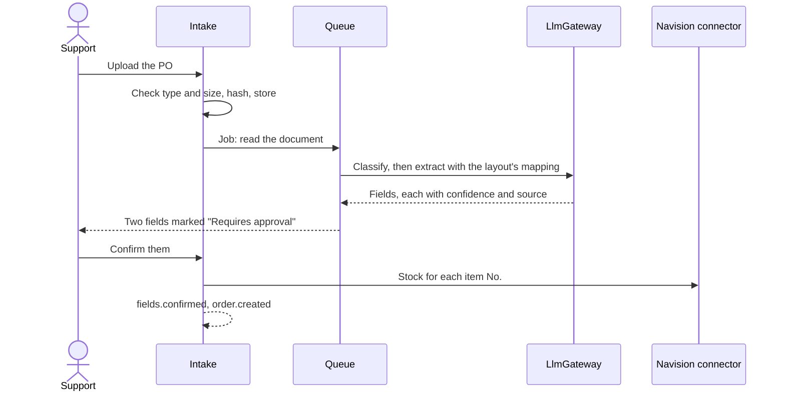

# Area 1: Document AI and integration

**Owner:** Richie. **Backup:** TBD until T-1. **Capabilities:** A, B and E, plus the platform. Paths and reviewers are in [module ownership](module-ownership.md#area-1-document-ai-and-integration-richie).

## Goal

Read each document once, and carry its data to every team and system that needs it. Area 1 owns the whole AI pipeline (intake, classification, extraction, confidence and its thresholds, and the review screen), layout mapping, the order's data and its documents with their provenance, master data, the Navision connector, and the platform the other areas build on, including the 3D scene.

### User stories

- As **Support**, I upload a PO or forward it by email, and OrderPilot tells me what type it is and reads its fields.
- As **Support**, I confirm only the fields the AI is unsure of, each marked "Requires approval" and linked to where it was found in the document.
- As **Support**, a PO in a new layout is mapped by the AI and approved by me, and the next one in that layout needs no help.
- As **Support**, I see each line's stock from Navision, matched on the item No.
- As **Support**, the same PO sent twice is caught as a duplicate.
- As a **teammate**, I build my area on a platform that already signs people in, checks permissions, queues jobs, publishes events and renders documents.

## Contracts

How area 1 meets the others ([How the areas connect](../../CLAUDE.md#how-the-areas-connect)). The event names below are proposals: P-7 drafts the order and event contract, and the team agrees it in Week 3, with every owner reviewing it.

| With   | Area 1 gives                                                                                                                                                           | Area 1 takes                                                                  |
| ------ | ---------------------------------------------------------------------------------------------------------------------------------------------------------------------- | ----------------------------------------------------------------------------- |
| Area 2 | The order's data and its documents (`order.created`, `fields.confirmed`); stock levels; the template engine for PIs, invoices and packing lists; AI drafts of messages | Requests for generated documents and drafts                                   |
| Area 3 | Documents with every field's value, confidence and source (`document.extracted`, `fields.confirmed`); master data and prices; AI explanations of exceptions            | Requests for explanations                                                     |
| Area 4 | AI usage records; the permissions guard, which calls area 4's policy; the audit writer; vendor PIs' bank details for the bank-detail check                             | The policy's decisions; which data may go to which AI provider; masking rules |

- **The AI pipeline stays whole in area 1:** classification, extraction, the confidence thresholds (which confidence needs a person, and which fields always do) and the review screen.
- **Area 1 owns the order's data, never its status,** which lives only in area 2's state machine.
- **Match on Navision numbers,** never on names. A look-alike name is shown as a possible match only.
- **Navision stays the system of record.** OrderPilot reads it, and any write-back needs a preview and an approval, against the mock only until Spectra agrees.
- **Shared code changes in small pull requests,** with the affected owners reviewing ([module ownership](module-ownership.md#shared-files-and-who-reviews-them)).

## Recommended design

- **A gateway over AI providers** (`LlmGateway`): mock by default, OpenAI-compatible by configuration, Bedrock optional. Structured output is validated with zod and retried. Documents are data: the model only returns fields, and nothing it returns triggers an action.
- **A pipeline of steps** on queues: store, sniff the type, extract text and page images, classify, extract with the layout's mapping, score confidence, and wait for a person where needed. Each step is idempotent and keyed by the document's content hash.
- **An adapter and a factory for connectors** (`SystemConnector`): one interface over named record kinds, one adapter per system, credentials only from the environment, a health probe and retries with backoff.
- **Provenance on every field:** value, confidence, source page and position, model, and who confirmed it.
- **Repositories** are the only place Prisma is called, in every module.

The intake sequence:

## What the base gives you

All planned. Area 1's core is part of the base itself, so these stories are Richie's to build (001, section 6), and each fills this section in as it lands:

- **The way of working:** the ground rules (P-1, merged), GitHub as code (P-2), these docs (P-3, P-4), the tooling (P-5) and CI with the security scans (P-6).
- **The app:** shared contracts (P-7), the API shell (P-8), the database, queues, storage and audit writer (P-9), sign-in and sessions (P-10), the web shell (P-11), common components (P-12), Docker images (P-13), the end-to-end smoke test (P-14), events and live updates (P-15) and diagrams as code (P-16).
- **Area 1's core:** the AI gateway with usage tracking and the destination check (P-17), document intake and storage (P-18), mock Navision and synthetic master data (P-19), the connector framework and the Navision adapter (P-20), and synthetic documents with planted mistakes and ground truth (P-21).
- **Later:** the design system with the Pro kits (P-22), the 3D order constellation (P-23), cloud deployment (P-24) and the slides (P-25).

## What's yours to build

Area 1's own stories, after the base (001, section 10), under epics A, B and E:

- **The AI pipeline:** classification; extraction with confidence and provenance; the review screen with source highlighting; the accuracy harness, with a 95% target and a comparison of models; learning from corrections, one layout at a time; layout mapping proposed by AI and approved by a person (E2E #2); prompt-injection tests; and email intake through a mock mailbox with signed webhooks.
- **Orders and Navision:** duplicate-PO protection (Sell-to Customer No. plus External Document No., and the content hash); a Navision-ready import file; and the template engine for PIs, invoices, packing lists and Excel, used by areas 2 and 3.
- **Could:** QR codes on generated documents and carton labels for the warehouse to scan; passkeys to confirm risky approvals, with area 4's policy deciding when; a first-run tour for each role; and an "Ask OrderPilot" help panel that answers from our docs, labelled as AI ([domain notes](../research/domain-notes.md)).

## At the Week 7 interview

Be ready to explain, in your own code:

- how a document moves from upload to confirmed fields, and where a person steps in;
- how confidence is scored, how the thresholds are set, and which fields always need a person;
- how the gateway keeps a model's output from ever triggering an action;
- how prompt injection is defended against, and how the tests prove it;
- how the connector framework lets the mock be swapped for the real Navision;
- how accuracy is measured against the ground truth;
- how the platform pieces the other areas use are kept stable.

## Risks

| Risk                                         | What to do                                                                                     |
| -------------------------------------------- | ---------------------------------------------------------------------------------------------- |
| Extraction accuracy falls short of 95%       | Measure per field and layout; tune mappings and thresholds; compare models                     |
| Spectra's Navision differs from the standard | Keep Navision behind the connector; update [the data formats](../data-formats.md) from samples |
| A client document reaches a third-party AI   | The mock is the default; area 4's destination check; samples only on the throwaway stack       |
| The base is late and teammates wait          | Phase A of prompt 002: everything a teammate needs merges first                                |
| The platform changes under the other areas   | Small shared pull requests, reviewed by the owners they affect                                 |

## Module requirements

| Requirement           | How area 1 covers it                                                                            |
| --------------------- | ----------------------------------------------------------------------------------------------- |
| M1 Design thinking    | Support's re-typing pain (HMW-1, HMW-2), and the problem statement and research                 |
| M2 GRS by design      | A person confirms AI output; the destination check; synthetic data; prompt-injection defence    |
| M3 AI-assisted coding | The AI gateway and usage tracking, and the AI usage log and prompts for the base                |
| M4 Best practices     | The platform's security, tests at every level, validation at boundaries and performance budgets |
| M5 Team Git workflow  | GitHub as code, the board, the ruleset and the pull request template                            |
| M6 Deploy and monitor | Docker, the cloud deployment and the AI usage records                                           |
