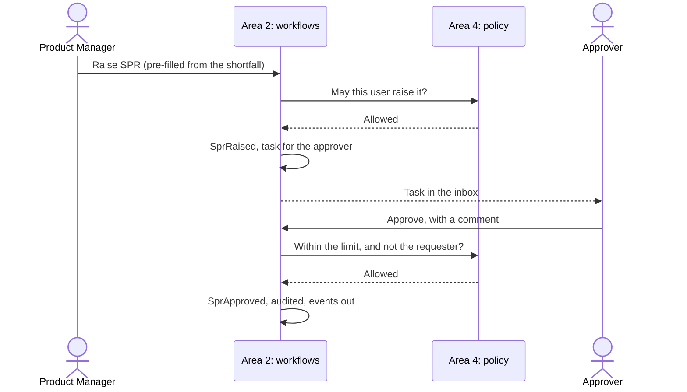

# Area 2: Order workflows and approvals

**Owner:** Azri. **Backup:** Iok Teck. **Capability:** C, with parts of E. Paths and reviewers are in [module ownership](module-ownership.md#area-2-order-workflows-and-approvals-azri).

## Goal

Move every order through Spectra's steps without anyone chasing. Area 2 owns the state machine that holds each order's status, the tasks it gives each role, SPR approval within limits, the payment gate, reminders and escalations, and the documents and notifications each step produces.

### User stories

- As a **Product Manager**, I raise an SPR from a shortfall with one button, and see who holds it and when it was decided.
- As the **approver**, I approve or reject an SPR within my limit, with a comment, and anything above my limit escalates.
- As **Support**, my inbox shows only the tasks that wait on me, oldest and most overdue first.
- As the **warehouse**, a packing task appears only once Finance has confirmed the payment.
- As **Finance**, confirming a payment opens the gate for packing, and the order moves on by itself.
- As **Logistics**, a missing AWB/BL or import permit reminds me before it is late, and escalates if I miss it.
- As **Management**, I can see how long each step takes and where orders wait.

## Contracts

How area 2 meets the others ([How the areas connect](../../CLAUDE.md#how-the-areas-connect)). The event names below are proposals: P-7 drafts the order and event contract, and the team agrees it in Week 3, with every owner reviewing it.

| With   | Area 2 gives                                                                                               | Area 2 takes                                                                                           |
| ------ | ---------------------------------------------------------------------------------------------------------- | ------------------------------------------------------------------------------------------------------ |
| Area 1 | Requests for generated documents (PI, invoice, packing list) through the template engine                   | The order and its documents (`order.created`, `fields.confirmed`); stock levels; AI drafts of messages |
| Area 3 | Every status change (`order.status-changed`) and task event (`task.overdue`), for the tracker and the KPIs | Check results (`check.completed`, pass or fail). Area 2 decides what a failure blocks                  |
| Area 4 | Each approval, release and payment action, to be checked before it happens                                 | The policy's decision on each action; payment holds (`payment.held`, `payment.hold-cleared`)           |

- **Order status lives only here.** No other area stores or computes an order's status. The order's data belongs to area 1; area 3 only reads the status.
- **Every transition is checked by area 4's policy,** on the server, before it runs. A refusal leaves the order as it was.
- **Every transition is audited,** with who, when, from which state to which, and why.
- **Open rules are configuration:** the SPR trigger, the PI sequence, approvers and limits, and delegation ([assumptions](../assumptions.md) A-21 to A-24).
- **Approval limits and delegation** follow the shape of Navision's Approval User Setup (Approver ID, Sales and Purchase Amount Approval Limits, Unlimited flags, Substitute), shared with area 4 ([domain notes](../research/domain-notes.md)).

## Recommended design

- **State machine as data.** A transition table: from state, event, guard, to state, effects. The machine is a domain class with no HTTP or Prisma, so every transition can be unit-tested. Azri writes it himself (C-2).
- **Commands for actions.** Each action (approve, reject, confirm payment, release) is a command with its own validation, checked by the policy, then applied by the machine.
- **Events out, through the outbox** (planned: P-15). A transition and its events commit in the same transaction, so a retry never loses or doubles one. Idempotency keys make a repeated command harmless.
- **Strategies for timing.** Reminder and escalation schedules are a Strategy, configured per step, run by BullMQ jobs (planned: P-9, P-15). Deadlines are in Singapore time.
- **Numbers.** OrderPilot's own records take a type prefix, the date and a running number, such as `SPR-20261102-0001` (planned: P-7 and C-1), shown beside Navision's numbers.

A first sketch of the sales flow's states, for Azri to rework in C-2:

`Received` → `Confirmed` → `StockChecked` → (`AwaitingSpr` → `SprApproved`) → `PiSent` → `AwaitingPayment` → `Paid` → `Packing` → `Invoiced` → `Released` → `AwaitingShippingDocuments` → `Closed`, with `OnHold` (an exception or a payment hold) and `Cancelled` reachable from most states.

The PO-to-approval sequence:

## What the base gives you

C-1 landed these. Every route and screen answers with typed mock data from `@orderpilot/synthetic-data` and says so (`meta.mock` in the response, the Mock and Synthetic demo data badges on screen), except the document configuration, which is read from its table.

- **Models** (`apps/api/prisma/schema/workflows.prisma`, migration `workflows_base`): `WorkflowDefinition`, `WorkflowInstance`, `WorkflowTask`, `WorkflowEvent`, `WorkflowNotification`, `PaymentConfirmation`, `WorkflowRecord`, `RecordCounter` and `DocumentTypeConfig`. The inbox queries have indexes on role, status and due date. `WorkflowInstance.status` is plain text that only your state machine writes; the base writes it in one place, the demo seed, with the dataset's `sample-` labels. Events carry an optional idempotency key, unique per instance, for your retries story.
- **Contracts** (`packages/shared/src/workflows`): tasks, order steps and timeline, SPR detail and decisions, reminders, payments with their type, the document configuration, and `ApprovalUserSetup`, the shape of Navision's Approval User Setup (approver, sales and purchase limits, the two unlimited flags, substitute). New permissions are additive: `workflows.read`, `spr.read`, `approvals.decide`, `payments.confirm` and `workflows.inboxes.any`, with the default matrix extended in `DEFAULT_ROLE_PERMISSIONS`.
- **Routes** (`apps/api/src/modules/workflows`, in layers; every one behind the global guards):
  - `GET /workflows/tasks` and `GET /workflows/reminders`: the caller's own inbox (`workflows.read`).
  - `GET /workflows/inboxes/:role/tasks` and `.../reminders`: any role's inbox (`workflows.inboxes.any`, which Management and Auditor hold).
  - `GET /workflows/orders/:orderNo/flow`: an order's steps, timeline and payment.
  - `POST /workflows/orders/:orderNo/payments`: a payment confirmation with its type (`payments.confirm`).
  - `GET /workflows/sprs/:recordNo`, `POST .../approve` and `POST .../reject` (`spr.read`, `approvals.decide`): the commands validate a comment, check the SPR exists and answer `applied: false`. They change nothing and say so.
  - `GET /workflows/document-config`: the fields and defaults for each document type, read from the `DocumentTypeConfig` table (seeded from `DEFAULT_DOCUMENT_CONFIG`), so a default is an edit to a row.
- **Two ports, bound to mocks.** `WorkflowReadModel` is where the routes read from (`MockWorkflowReadModel`); `ApprovalPolicy` is what area 2 asks of area 4 (`MockApprovalPolicy`, rows in Approval User Setup shape). Swap each by providing a real class under the same token; the controller, service and screens stay. [ADR 0026](../adr/0026-area-2-base-ports-and-mocks.md) has the reasoning.
- **Record numbers.** `RecordNumberService.next("SPR")` gives `SPR-20261102-0001` through the shared helper, from one atomic upsert on `RecordCounter`, so concurrent requests never share a number (tested against the database). `WorkflowRecord.navisionNo` holds Navision's number beside it, null until Navision has the record. Both numbers show together on every screen.
- **The SPR pre-fill.** `SprSuggestion` works out available stock (Inventory, minus Qty. on Sales Order, plus Qty. on Purch. Order) and suggests the shortfall. The SPR page marks suggested fields as suggestions, default fields as defaults and typed ones as entered by a person. It is arithmetic only: when to raise an SPR is yours.
- **Payment type.** The confirmation form and contract carry `prepayment`, `deposit`, `balance` or `full-payment` (area 4's list, imported from the governance contracts). Prepayment is what your payment gate will watch.
- **Screens** (`apps/web/src/features/workflows`, strings in the lazy `workflows` namespace, generated hooks only):
  - `/workflows`: the task inbox. Each role sees its own; Management and Auditor pick a role. The warehouse view is a tablet layout with 44 px or larger targets.
  - `/workflows/orders/:orderNo`: steps, timeline and payment, with the confirm-payment form for Finance.
  - `/workflows/sprs/:recordNo`: the SPR approval page. One primary button (Approve), Reject beside it, a required comment, suggested fields marked.
  - `/workflows/reminders`: what is due, who was told, and where it goes if nobody acts.
  - Each covers loading, empty with a next action, error with retry and a trace id, permission denied and success. Screenshots are in `docs/design/screenshots/area-2`.
- **Test skeleton** (`workflows.todo.test.ts`): `it.todo` for transitions, SPR limits, the payment gate, reminders and escalations, and retries with idempotency. Real tests cover the pieces the base wrote: the mock data against the contracts, the shortfall arithmetic, record numbers (including concurrent requests), the routes and their permissions, and each screen.
- **From the platform:** the shared contracts, roles and permissions (P-7); the API shell (P-8); the database, queues and audit writer (P-9); sign-in and the permissions guard (P-10); the web shell (P-11) and common components (P-12); the generated hooks and mocks (P-26). Still to come from the platform: the event bus, outbox, worker and live updates (P-15).

## What's yours to build

**Starter stories,** ready to pull on the board (planned: P-2 seeds them):

- **C-2: the state machine,** with the sales flow's states and transitions. Written again by Azri as his first story, so that it stays his work.
- **C-3: SPR approval within limits,** with escalation above the limit.
- **C-4: reminders and escalations,** per step, from configuration.

**Left out of the base on purpose,** so it stays yours:

- the state machine and the order's real status (C-2): the steps list in `domain/sales-flow.ts` is keys, labels and owners only, with no transitions, guards or due dates;
- Spectra's sales and purchase flows;
- the SPR rules: when an SPR is raised, the limit check, escalation above the limit, vendor choice and pack-size rounding (C-3);
- the payment gate;
- the SLA logic: the due dates in the mock data are fixtures, not a rule (C-4);
- area 4's real approval policy: `MockApprovalPolicy` is the stand-in, and area 4 owns the limits and substitutes;
- a Prisma-backed read model and the commands' real effects: the routes answer from the mock until you bind your own.
- a count on the role home tiles: the tile system shows a dash for every area, so a live count is a change to the shared tile, left for a later story (C-5 in the backlog).

**The deeper work,** for the A-level depth:

- the payment gate (Should 1), with area 4's policy and Finance's confirmation;
- the PI draft for Support (Should 2), on area 1's template engine;
- AWB/BL and import-permit follow-ups (Should 4);
- notifications with drafts that the AI writes and a person sends (Should 5, with area 1);
- delegation and substitutes while the approver is away;
- the purchase flow (phase 2): an SPR becomes a vendor PO draft, payment holds from area 4 block it, and a reminder fires when payment falls due;
- full test coverage: every legal transition, every illegal one refused, retries and duplicate commands, and timeouts that escalate. 100% of workflow tests pass.

## Options to consider, not built

Tools that may suit this area. None is installed, pinned or built ([ADR 0020](../adr/0020-options-left-to-the-owners.md)). If you adopt one, bring its ADR, an exact pinned version and a row in the traceability matrix with that story.

- **XState** for the order state machine's transitions. Azri's transition table as data is the plan; XState is worth it only if it makes the machine easier to test and explain. The state machine stays the only holder of order status either way.

## At the Week 7 interview

Be ready to explain, in your own code:

- why order status lives only in your state machine, and how other areas read it;
- how a transition is guarded, applied, audited and published, in one transaction;
- how idempotency keys stop a retried command from running twice;
- how SPR limits and escalations work, and where the limits come from;
- how reminders are scheduled, and what happens when the worker restarts;
- how your tests prove that illegal transitions are refused.

## Risks

| Risk                                                 | What to do                                                                   |
| ---------------------------------------------------- | ---------------------------------------------------------------------------- |
| The state machine grows tangled as Should items land | Keep it as a table; add states only through the transition table, with tests |
| Spectra's rules differ from our assumptions          | Keep every open rule in configuration; never hard-code a limit or a sequence |
| A retry or a double click moves an order twice       | Idempotency keys and the outbox; test duplicate commands                     |
| Reminders flood people                               | One reminder per task per schedule step; escalate instead of repeating       |
| Status logic leaks into other areas                  | Review other areas' pull requests that touch status; publish events instead  |

## Module requirements

| Requirement           | How area 2 covers it                                                                  |
| --------------------- | ------------------------------------------------------------------------------------- |
| M1 Design thinking    | The future journey's steps and the approver's and Support's pains (HMW-3 to HMW-5)    |
| M2 GRS by design      | Approval limits, the payment gate and audited transitions, with area 4's policy       |
| M3 AI-assisted coding | Prompts kept as `area2-NNN-…`, and rows in the AI usage log                           |
| M4 Best practices     | A tested state machine, validation at boundaries, idempotency and 100% workflow tests |
| M5 Team Git workflow  | Stories on the board, one branch and pull request each, reviews within a day          |
| M6 Deploy and monitor | Approval turnaround and overdue steps, measured from workflow events                  |
