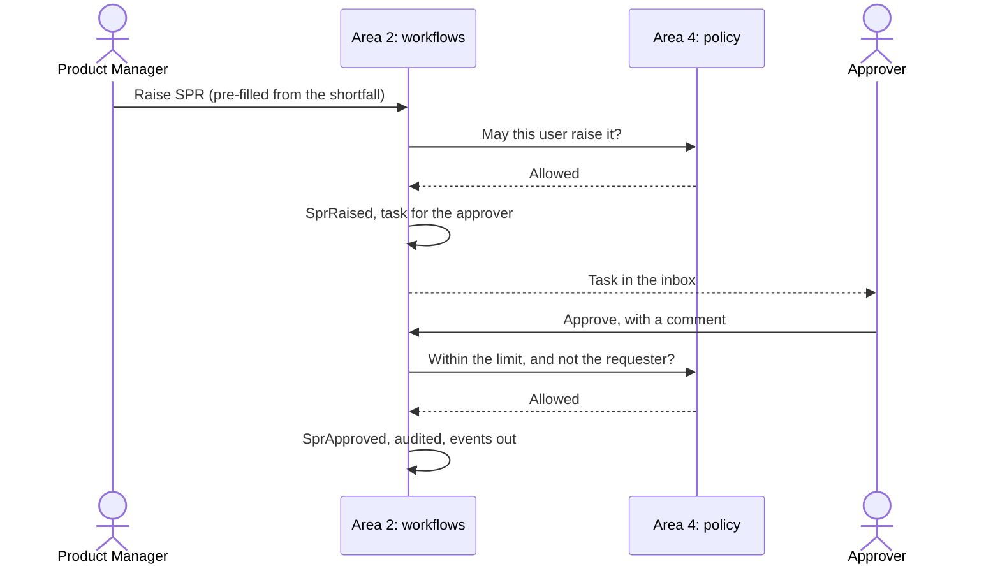

# Area 2: Order workflows and approvals

**Owner:** Azri. **Backup:** Iok Teck. **Capability:** C, with parts of E. Paths and reviewers are in [module ownership](module-ownership.md#area-2-order-workflows-and-approvals-azri).

## Goal

Move every order through Spectra's steps without anyone chasing. Area 2 owns the state machine that holds each order's status, the tasks it gives each role, SPR approval within limits, the payment gate, reminders and escalations, and the documents and notifications each step produces.

### User stories

- As a **Product Manager**, I raise an SPR from a shortfall with one button, and see who holds it and when it was decided.
- As the **approver**, I approve or reject an SPR within my limit, with a comment, and anything above my limit escalates.
- As **Support**, my inbox shows only the tasks that wait on me, oldest and most overdue first.
- As the **warehouse**, a packing task appears only once Finance has confirmed the payment.
- As **Finance**, confirming a payment opens the gate for packing, and the order moves on by itself.
- As **Logistics**, a missing AWB/BL or import permit reminds me before it is late, and escalates if I miss it.
- As **Management**, I can see how long each step takes and where orders wait.

## Contracts

How area 2 meets the others ([How the areas connect](../../CLAUDE.md#how-the-areas-connect)). The event names below are proposals: P-7 drafts the order and event contract, and the team agrees it in Week 3, with every owner reviewing it.

| With   | Area 2 gives                                                                                               | Area 2 takes                                                                                           |
| ------ | ---------------------------------------------------------------------------------------------------------- | ------------------------------------------------------------------------------------------------------ |
| Area 1 | Requests for generated documents (PI, invoice, packing list) through the template engine                   | The order and its documents (`order.created`, `fields.confirmed`); stock levels; AI drafts of messages |
| Area 3 | Every status change (`order.status-changed`) and task event (`task.overdue`), for the tracker and the KPIs | Check results (`check.completed`, pass or fail). Area 2 decides what a failure blocks                  |
| Area 4 | Each approval, release and payment action, to be checked before it happens                                 | The policy's decision on each action; payment holds (`payment.held`, `payment.hold-cleared`)           |

- **Order status lives only here.** No other area stores or computes an order's status. The order's data belongs to area 1; area 3 only reads the status.
- **Every transition is checked on the server before it runs:** by role in the state machine's table, or, for SPR decisions, by area 4's policy. A refusal leaves the order as it was.
- **Every transition is audited,** with who, when, from which state to which, and why.
- **Open rules are configuration:** the SPR trigger, the PI sequence, approvers and limits, and delegation ([assumptions](../assumptions.md) A-21 to A-24).
- **Approval limits and delegation** follow the shape of the Approval User Setup in Microsoft Dynamics 365 Business Central (Approver ID, Sales and Purchase Amount Approval Limits, Unlimited flags, Substitute), shared with area 4 ([domain notes](../research/domain-notes.md)).

## Recommended design

- **State machine as data.** A transition table: from state, event, guard, to state, effects. The machine is a domain class with no HTTP or Prisma, so every transition can be unit-tested. Azri writes it himself (C-2).
- **Commands for actions.** Each action (approve, reject, confirm payment, release) is a command with its own validation, checked by the policy, then applied by the machine.
- **Events out, through the outbox** (planned: P-15). A transition and its events commit in the same transaction, so a retry never loses or doubles one. Idempotency keys make a repeated command harmless.
- **Strategies for timing.** Reminder and escalation schedules are a Strategy, configured per step, run by BullMQ jobs (planned: P-9, P-15). Deadlines are in Singapore time.
- **Numbers.** OrderPilot's own records take a type prefix, the date and a running number, such as `SPR-20261102-0001` (planned: P-7 and C-1), shown beside Business Central's numbers.

The PO-to-approval sequence:

## The state machine (C-2)

`workflows/domain/order-state-machine.ts` holds the sales flow as a table, and `OrderWorkflowService` runs it against the database ([ADR 0042](../adr/0042-the-order-state-machine-as-a-table.md)). No other code decides an order's status.

| Event                         | From                                            | To                          | Who                                |
| ----------------------------- | ----------------------------------------------- | --------------------------- | ---------------------------------- |
| `FIELDS_CONFIRMED`            | `Received`                                      | `Confirmed`                 | `SUPPORT`                          |
| `STOCK_CHECKED`               | `Confirmed`                                     | `StockChecked`              | `PRODUCT_MANAGER`                  |
| `SPR_RAISED`                  | `StockChecked`                                  | `AwaitingSpr`               | `PRODUCT_MANAGER`                  |
| `SPR_APPROVED`                | `AwaitingSpr`                                   | `SprApproved`               | a person; area 4's policy says who |
| `SPR_REJECTED`                | `AwaitingSpr`                                   | `StockChecked`              | a person; area 4's policy says who |
| `SPR_DECISION_UNDONE`         | `SprApproved`, `StockChecked`                   | `AwaitingSpr`               | a person; area 4's policy says who |
| `SPR_RAISE_WITHDRAWN`         | `AwaitingSpr`                                   | `StockChecked`              | `PRODUCT_MANAGER`                  |
| `PI_SENT`                     | `StockChecked`, `SprApproved`                   | `AwaitingPayment`           | `SUPPORT`                          |
| `PAYMENT_CONFIRMED`           | `AwaitingPayment`                               | `Paid`                      | `FINANCE`                          |
| `PACKING_STARTED`             | `AwaitingPayment`, `Paid`                       | `Packing`                   | `WAREHOUSE`                        |
| `INVOICED`                    | `Packing`                                       | `Invoiced`                  | `SUPPORT`                          |
| `RELEASED`                    | `Invoiced`                                      | `Released`                  | `WAREHOUSE`                        |
| `SHIPPING_DETAILS_SENT`       | `Released`                                      | `AwaitingShippingDocuments` | `SUPPORT`                          |
| `SHIPPING_DOCUMENTS_RECEIVED` | `AwaitingShippingDocuments`                     | `Closed`                    | `LOGISTICS`                        |
| `HOLD_RAISED`                 | any but `Closed` and `Cancelled`                | `OnHold`                    | the system                         |
| `HOLD_CLEARED`                | `OnHold`                                        | back where it was           | the system                         |
| `CANCELLED`                   | up to `Invoiced`, or `OnHold` if held from them | `Cancelled`                 | `SUPPORT`                          |

`Closed` and `Cancelled` are final. The rules the table cannot express:

- **The stock check:** `FIELDS_CONFIRMED` needs every uncertain field confirmed. On a shortfall, `PI_SENT` from `StockChecked` is refused until an SPR is approved (`sprRequiredOnShortfall`, an open rule: A-21).
- **The payment gate:** with a prepayment due, `PACKING_STARTED` from `AwaitingPayment` is refused. `PAYMENT_CONFIRMED` opens the gate only for `prepayment` or `full-payment`, and only if it covers the amount due. With no prepayment, packing goes straight ahead.
- **Rejecting an SPR:** needs a reason, and returns the order to `StockChecked`.
- **Holds:** a failed check or a payment hold moves the order to `OnHold`. A check's hold belongs to its rule, so one rule passing never frees an order another rule still holds. The order returns only when every hold has cleared.
- **Cancelling:** needs a reason, and is refused once the goods have gone.

A wrong actor is refused with 403 and an illegal move with 409, in the one error envelope, and each refusal is audited. Where a status meets Business Central's Sales Header Status is `navisionStatusOf`, an assumption to confirm (A-36).

**SPR approval (C-3).** `POST /workflows/sprs/:recordNo/approve`, `reject` and `undo` are real: `SprApprovalService` asks area 4's policy, the machine moves the order, and the decision commits with the move. The amount and the requester come from the SPR's own record (`WorkflowRecord.data`), never from the request. Above the decider's limit, approving or rejecting decides nothing: the SPR passes to the next person on the chain (`deciderFor`), and area 4's route rule follows the chain from that hand-off: the person who passed it on, or the absent approver a substitute stood in for. The original requester is refused separately, whoever it has passed through. The seed puts the orders with a submitted SPR on the machine as `AwaitingSpr`, and the short orders whose SPR is only suggested as `StockChecked`; the rest stay samples, and deciding one is refused.

**The SPR thread (#251, #290).** On an order the machine runs, the SPR's tasks follow it from one team to the next, stored as `WorkflowTask` rows beside the mock's tasks:

- **Raise.** The product manager's Raise task (on My tasks, or the SPR page's own Raise button) is `SPR_RAISED`: `SprRaiseService` gives the SPR its record (amount and requester, from the dataset, never the request), closes the Raise task and opens the approvers' `APPROVE_SPR` task, all in the one commit. Undo is `SPR_RAISE_WITHDRAWN`, allowed while nobody has decided it.
- **Decide.** Any one approver decides, and a second decision is refused with 409, as before.
- **Hand back.** An approval opens the product manager's `PLACE_VENDOR_PO` task (place the vendor PO in Business Central; marking it done only closes the task, because the machine already waits for Support's PI). A rejection reopens the Raise task, so the product manager corrects the SPR and raises it again, from My tasks or the SPR page. Undoing the decision closes whichever task it opened.
- **What the page shows.** `GET /workflows/sprs/:recordNo` answers a `stage` (`suggested`, `with-approvers`, `decided`) and the `raiseTaskId` when the product manager can raise it, so the page says "Not raised yet" with no decision form until then.

`RunningTaskActions` completes and undoes these tasks: only the task's own role (403, audited), only the kinds finished by marking them done (409), only while open (404). The approvers are still one Approver inbox with the substitute chain; when Angelyn's approver group (#327) merges, a follow-up swaps the chain for its `approversFor`.

**Who receives an SPR (C-3).** `SprRoutingService` asks area 4's `deciderFor` who holds each SPR waiting for a decision, on every read. It is never stored, so a task follows an approver going away and coming back, or a change to the setup, with nothing to move it. An SPR with a substitute, an escalation, a pass-on, or a named approver outside the Approver role leaves the Approver's inbox and appears under "Waiting for you" for that person, with why it came to them. Management has no role inbox, which is why this is its own route and section. Each task says whether the person can act, from area 4's policy, because a role can be named on the chain without holding `approvals.decide`. When nobody on the chain can act, only the requester, or someone who cannot see tasks at all, the SPR stays in the Approver's inbox, so that it stays in sight.

**What the briefing changes for this area.** [What Spectra said](../assumptions.md#what-the-briefing-said) conflicts with what is built in three ways, and each waits on an answer, so nothing has been rebuilt on a guess:

- **Who approves.** Built: one approver with a limit, then a chain above them. Spectra: a facilitator passes each SPR to a group of three, and no limits were mentioned (Q-28). The seeded 5,000.00 limit and the chain are placeholders. Group approval is not built.
- **What a shortage does.** Built: the sales flow holds an order at an SPR when stock is short. Spectra: the customer revises the PO or takes what is there, and SPRs are for purchases (Q-25). If that holds, C-3's approval belongs to the purchase flow, and the sales flow's rule `sprRequiredOnShortfall` should default to off.
- **"Return remarks."** Built: approve or reject. Spectra may mean a third outcome (Q-30).

**Reminders and escalations (C-4).** `WorkflowTaskSla` holds, per kind of task, when it is due, how long before that the owner is reminded, how long after it escalates, and to which role. `GET /workflows/sla-settings` reads it, and `PUT /workflows/sla-settings/:taskKind` changes it (`settings.manage`, audited). There is no screen yet. Spectra asked for one of these: an approval not actioned in 24 hours goes to the management team, which is the seeded `APPROVE_SPR` row. The rest are our drafts (A-37). `TaskSweepService` finds open tasks on orders the machine runs and sends what has come due, as a repeating BullMQ job (`WorkflowSweepJob`, every `WORKFLOW_SWEEP_SECONDS`). A notice, its workflow event and its audit event commit together, and `task.overdue` is recorded at the due time itself. D-4 can read these events for the tracker's overdue flag, but the tracker does not yet: it still uses its mock. Each notice has a key the database holds only once, so a retried or doubled job cannot send it twice. A reminder goes to whoever holds the SPR, and a new holder is told once too, while an escalation goes once, to the role in the settings. A task on a held order gets no notices, because nobody can act on it. If the role named for an escalation can no longer see tasks, the sweep fails loudly and sends it once it can. A decision closes the task, which stops its notices and takes them off `GET /workflows/reminders/for-me`, and an undo reopens it. Nothing here sends anything outside the app itself.

**The 24-hour email (#251, point 3).** When an SPR approval's escalation goes out, the sweep also hands an `ApprovalOverdueNotifier` port (`domain/approval-overdue-notifier.ts`) the overdue SPR: its task, order and SPR numbers, when it was due, and the approver group from area 4's `approversFor`, each by id and name only. It carries no amount, price or contact, so nothing reaches a mailbox that masking would hide; the email links to the SPR. The whole group is asked to approve it or to reply with remarks, once: the escalation's key is passed on, and the sweep never calls it again for the same task. The coordinator gets no copy until Spectra says so. The call is inside the escalation's transaction, so if it fails nothing is kept and the next sweep tries again with the same key; the adapter sends at most one email per key and approver. Area 1's P-100 implements the adapter (the mail sender, to Mailpit only). Until then `LogApprovalOverdueNotifier` logs a count and sends nothing.

**What happens when the worker restarts.** Nothing is lost and nothing is sent twice: the sweep works out what is due from each task's start time and the settings, and the next run finds whatever was missed. A long outage can send a reminder and an escalation together.

**Retries with an idempotency key (follows C-2).** `POST /workflows/sprs/:recordNo/approve`, `reject` and `undo` take an optional `Idempotency-Key` header. `CommandReplayService` runs a command once per person and key. It claims the key in `WorkflowCommand` before the command runs, and the command writes its answer there inside its own transaction. A repeat with the same key gets that answer and runs nothing, even after an undo. A copy sent while the first is still running finds the claim and waits for the answer, up to five seconds, and is then told to try again with 409. While the first succeeds, the copy never runs the command, so it writes no refusal. A command that fails gives its claim back, so a waiting copy or a later retry runs it again, and is refused and audited again. A claim left by a command that stopped is taken over after a minute. The same key with a different command, SPR or comment is refused with 409. Without a key, a command behaves as before. Keys are per person, so two people never collide.

**How other areas use it:** `WorkflowOrderStatusReader` implements area 3's `OrderStatusReader`, and `WorkflowCheckReporter` implements its `CheckReporter`: a failed check holds the order and that rule passing clears it. Both are exported from `WorkflowsModule` for area 3 to bind in place of its mock. `OrderWorkflowService` underneath has `statusOf`, `statusOfMany`, `start`, `apply`, and `decideSpr`, which asks area 4's policy first.

**Not done yet:**

- The routes and screens still answer from the mock until a story binds them (C-3 is the first). A seeded sample order is not the machine's to run, so the tracker needs its mock until the demo's orders run on the machine.
- Events are saved as rows and not published until P-15.
- **The browser does not send an Idempotency-Key yet.** Area 1's generated client and `ApiClient` drop extra headers. Passing it on is the next pull request, with Richie's review.
- **Only the SPR commands take a key.** The task and payment commands still run on the mock overlay, and take one when C-5 moves them to the database.
- **Keys never expire.** `WorkflowCommand` keeps every one. Clearing out old ones can use its `createdAt` index later.
- **The kept answer includes the comment,** as the SPR's record and the audit trail do, and it is kept for good. How long to keep it is a question for area 4's retention rules.
- **A key is tied to the SPR's number.** A retry across midnight on a sample SPR, whose number moves with the date, is refused as a different request.
- Area 4's policy knows only approval actions, so other moves are checked by role alone.
- **"Waiting for you" is only on the task inbox page.** The home page's queue and the My tasks count read the role's inbox, so they do not show it. The home page is area 1's.
- **An oversight role picking the Approver's inbox does not see a handed SPR.** The holder does, and the order tracker shows the order.
- **The inbox is still by role.** With more than one approver, each sees the others' tasks and is refused if they try to decide. This needs the real read model.
- **Every inbox read works out the routing for every waiting SPR.** That is cheap on the demo's dozens, but needs batching once real volumes arrive.
- **Spectra asked for an email, and this sends an in-app notice.** Whether we may send real email, and to whom, is Q-29.
- **The sweep runs inside the API,** because the worker consumes no queue until P-15. Moving it means giving the worker a way to start `WorkflowSweepJob`. If its scheduler cannot be registered when the API starts, it is logged and tried again only at the next start.
- **Only tasks on orders the machine runs get real notices,** which today means SPR approvals. The state machine does not create tasks yet, so other steps have only seeded samples, and their reminders on the Reminders page are still mock data.
- **The Reminders page shows two things:** "Sent to you" is real, and the list below it is still the mock.
- **The bell still reads the mock for every role, and is off for roles with no inbox** (`Notifications.tsx`, area 1), so real notices appear only on the Reminders page.
- **Every overdue follow-up is not yet visible to everyone.** The role the settings name sees an escalation, but an oversight role has no list of them, and between the due time and the escalation only the owner's reminder shows. The tracker's flag (D-4) is what closes this.
- **An undo keeps the task's original clock,** and notices already sent do not go again. An undo long after a decision can therefore send a reminder and an escalation straight away.
- **A hold does not stop the clock.** After a long hold, the first sweep can send a reminder and an escalation together, though nobody could act during it.
- **A former holder keeps the reminder they were sent** while the task stays open, after the SPR moves on.
- **A run in progress at shutdown can fail,** if the database closes first. Each notice rolls back, and the next run sends it.
- **A notice cannot be marked as read.** It clears when the task is done.
- **When a passed-on SPR comes back because nobody above can act,** the Approver sees it again, but the page still says it waits for the person it was passed to. Deciding it above the limit is refused with a plain message.
- The approver and limits panel on the SPR page still comes from `MockApprovalPolicy`, and the page still shows the Mock badge because most of it is sample data.
- The demo data has no SPR above 5,000.00, and only orders with a submitted SPR run on the machine.
- The PI sequence (A-22) is in the table, not yet a setting, and `sprRequiredOnShortfall` has only its default. `SHIPPING_DOCUMENTS_RECEIVED` is one event for the AWB/BL and the permit until the follow-ups (Should 4) split them.
- A deposit followed by a balance does not open the gate, even if together they cover the prepayment: a question for Spectra.

## What the base gives you

C-1 landed these. Every route and screen answers with typed mock data from `@orderpilot/synthetic-data` and says so (`meta.mock` in the response, the Mock and Synthetic demo data badges on screen), except the document configuration, which is read from its table.

- **Models** (`apps/api/prisma/schema/workflows.prisma`, migration `workflows_base`): `WorkflowDefinition`, `WorkflowInstance`, `WorkflowTask`, `WorkflowEvent`, `WorkflowNotification`, `PaymentConfirmation`, `WorkflowRecord`, `RecordCounter` and `DocumentTypeConfig`. The inbox queries have indexes on role, status and due date. `WorkflowInstance.status` is plain text that only your state machine writes; the base writes it in one place, the demo seed, with the dataset's `sample-` labels. Events carry an optional idempotency key, unique per instance, for your retries story.
- **Contracts** (`packages/shared/src/workflows`): tasks, order steps and timeline, SPR detail and decisions, reminders, payments with their type, the document configuration, and `ApprovalUserSetup`, the shape of Business Central's Approval User Setup (approver, sales and purchase limits, the two unlimited flags, substitute). New permissions are additive: `workflows.read`, `spr.read`, `approvals.decide`, `payments.confirm` and `workflows.inboxes.any`, with the default matrix extended in `DEFAULT_ROLE_PERMISSIONS`.
- **Routes** (`apps/api/src/modules/workflows`, in layers; every one behind the global guards):
  - `GET /workflows/tasks` and `GET /workflows/reminders`: the caller's own inbox (`workflows.read`).
  - `GET /workflows/tasks/handed-to-me`: the SPRs the approval chain has handed to the caller, whatever their role (`workflows.read`).
  - `GET /workflows/reminders/for-me`: the reminders and escalations sent to the caller or their role (`workflows.read`).
  - `GET /workflows/sla-settings` and `PUT /workflows/sla-settings/:taskKind`: the timing of each kind of task (`settings.manage`).
  - `GET /workflows/inboxes/:role/tasks` and `.../reminders`: any role's inbox (`workflows.inboxes.any`, which Management and Auditor hold).
  - `GET /workflows/orders/:orderNo/flow`: an order's steps, timeline and payment.
  - `POST /workflows/orders/:orderNo/payments`: a payment confirmation with its type (`payments.confirm`).
  - `GET /workflows/sprs/:recordNo`, `POST .../approve` and `POST .../reject` (`spr.read`, `approvals.decide`): the commands validate a comment, check the SPR exists and answer `applied: false`. They change nothing and say so.
  - `GET /workflows/document-config`: the fields and defaults for each document type, read from the `DocumentTypeConfig` table (seeded from `DEFAULT_DOCUMENT_CONFIG`), so a default is an edit to a row.
- **Two ports, bound to mocks.** `WorkflowReadModel` is where the routes read from (`MockWorkflowReadModel`); `ApprovalPolicy` is what area 2 asks of area 4 (`MockApprovalPolicy`, rows in Approval User Setup shape). Swap each by providing a real class under the same token; the controller, service and screens stay. [ADR 0026](../adr/0026-area-2-base-ports-and-mocks.md) has the reasoning.
- **Record numbers.** `RecordNumberService.next("SPR")` gives `SPR-20261102-0001` through the shared helper, from one atomic upsert on `RecordCounter`, so concurrent requests never share a number (tested against the database). `WorkflowRecord.navisionNo` holds Business Central's number beside it, null until Business Central has the record. Both numbers show together on every screen.
- **The SPR pre-fill.** `SprSuggestion` works out available stock (Inventory, minus Qty. on Sales Order, plus Qty. on Purch. Order) and suggests the shortfall. The SPR page marks suggested fields as suggestions, default fields as defaults and typed ones as entered by a person. It is arithmetic only: when to raise an SPR is yours.
- **Payment type.** The confirmation form and contract carry `prepayment`, `deposit`, `balance` or `full-payment` (area 4's list, imported from the governance contracts). Prepayment is what your payment gate will watch.
- **Screens** (`apps/web/src/features/workflows`, strings in the lazy `workflows` namespace, generated hooks only):
  - `/workflows`: the task inbox. Each role sees its own; Management and Auditor pick a role. The warehouse view is a tablet layout with 44 px or larger targets.
  - `/workflows/orders/:orderNo`: steps, timeline and payment, with the confirm-payment form for Finance.
  - `/workflows/sprs/:recordNo`: the SPR approval page. One primary button (Approve), Reject beside it, a required comment, suggested fields marked.
  - `/workflows/reminders`: what is due, who was told, and where it goes if nobody acts.
  - Each covers loading, empty with a next action, error with retry and a trace id, permission denied and success. Screenshots are in `docs/design/screenshots/area-2`.
- **Test skeleton** (`workflows.todo.test.ts`): `it.todo` for transitions, SPR limits, the payment gate, reminders and escalations, and retries with idempotency. Real tests cover the pieces the base wrote: the mock data against the contracts, the shortfall arithmetic, record numbers (including concurrent requests), the routes and their permissions, and each screen.
- **From the platform:** the shared contracts, roles and permissions (P-7); the API shell (P-8); the database, queues and audit writer (P-9); sign-in and the permissions guard (P-10); the web shell (P-11) and common components (P-12); the generated hooks and mocks (P-26). Still to come from the platform: the event bus, outbox, worker and live updates (P-15).

## What's yours to build

**Starter stories,** ready to pull on the board (planned: P-2 seeds them):

- **C-2: the state machine:** built, in [the section above](#the-state-machine-c-2).
- **C-3: SPR approval within limits:** built, in [the section above](#the-state-machine-c-2). An SPR above the approver's limit reaches Management, which may decide it within its own limit since Management's permission was settled on 8 Nov 2026 (#215, ADR 0041).
- **C-4: reminders and escalations:** built for tasks on orders the machine runs, in [the section above](#the-state-machine-c-2). Still to do: a reminder to Logistics about shipping documents, because that step creates no real task yet, and drafts to customers and vendors (Should 5). E2E #1's reminder works only on the seeded orders the machine runs, until the machine creates tasks.

**Left out of the base on purpose,** so it stays yours:

- the routes' move onto the state machine (C-2 built the machine; the steps list in `domain/sales-flow.ts` is still keys, labels and owners only);
- Spectra's sales and purchase flows;
- the SPR rules: when an SPR is raised, the limit check, escalation above the limit, vendor choice and pack-size rounding (C-3);
- the payment gate's route and screen (C-2 built its rule in the machine);
- the due dates shown in the inbox are still fixtures, because the inbox reads the mock. The stored ones and "Sent to you" follow the settings (C-4);
- area 4's real approval policy: `MockApprovalPolicy` is the stand-in, and area 4 owns the limits and substitutes;
- a Prisma-backed read model and the commands' real effects: the routes answer from the mock until you bind your own.
- a count on the role home tiles: the tile system shows a dash for every area, so a live count is a change to the shared tile, left for a later story (C-5 in the backlog).

**The deeper work,** for the A-level depth:

- the payment gate (Should 1), with area 4's policy and Finance's confirmation;
- the PI draft for Support (Should 2), on area 1's template engine;
- AWB/BL and import-permit follow-ups (Should 4);
- notifications with drafts that the AI writes and a person sends (Should 5, with area 1);
- the purchase flow (phase 2): an SPR becomes a vendor PO draft, payment holds from area 4 block it, and a reminder fires when payment falls due;
- full test coverage: every legal transition, every illegal one refused, retries and duplicate commands, and timeouts that escalate. 100% of workflow tests pass.

## Options to consider, not built

Tools that may suit this area. None is installed, pinned or built ([ADR 0020](../adr/0020-options-left-to-the-owners.md)). If you adopt one, bring its ADR, an exact pinned version and a row in the traceability matrix with that story.

- **XState** for the order state machine's transitions. Azri's transition table as data is the plan; XState is worth it only if it makes the machine easier to test and explain. The state machine stays the only holder of order status either way.

## At the Week 7 interview

Be ready to explain, in your own code:

- why order status lives only in your state machine, and how other areas read it;
- how a transition is guarded, applied, audited and published, in one transaction;
- how idempotency keys stop a retried command from running twice;
- how SPR limits and escalations work, and where the limits come from;
- how reminders are scheduled, and what happens when the worker restarts;
- how your tests prove that illegal transitions are refused.

## Risks

| Risk                                                 | What to do                                                                   |
| ---------------------------------------------------- | ---------------------------------------------------------------------------- |
| The state machine grows tangled as Should items land | Keep it as a table; add states only through the transition table, with tests |
| Spectra's rules differ from our assumptions          | Keep every open rule in configuration; never hard-code a limit or a sequence |
| A retry or a double click moves an order twice       | Idempotency keys and the outbox; test duplicate commands                     |
| Reminders flood people                               | One reminder per task per schedule step; escalate instead of repeating       |
| Status logic leaks into other areas                  | Review other areas' pull requests that touch status; publish events instead  |

## Module requirements

| Requirement           | How area 2 covers it                                                                  |
| --------------------- | ------------------------------------------------------------------------------------- |
| M1 Design thinking    | The future journey's steps and the approver's and Support's pains (HMW-3 to HMW-5)    |
| M2 GRS by design      | Approval limits, the payment gate and audited transitions, with area 4's policy       |
| M3 AI-assisted coding | Prompts kept as `area2-NNN-…`, and rows in the AI usage log                           |
| M4 Best practices     | A tested state machine, validation at boundaries, idempotency and 100% workflow tests |
| M5 Team Git workflow  | Stories on the board, one branch and pull request each, reviews within a day          |
| M6 Deploy and monitor | Approval turnaround and overdue steps, measured from workflow events                  |
