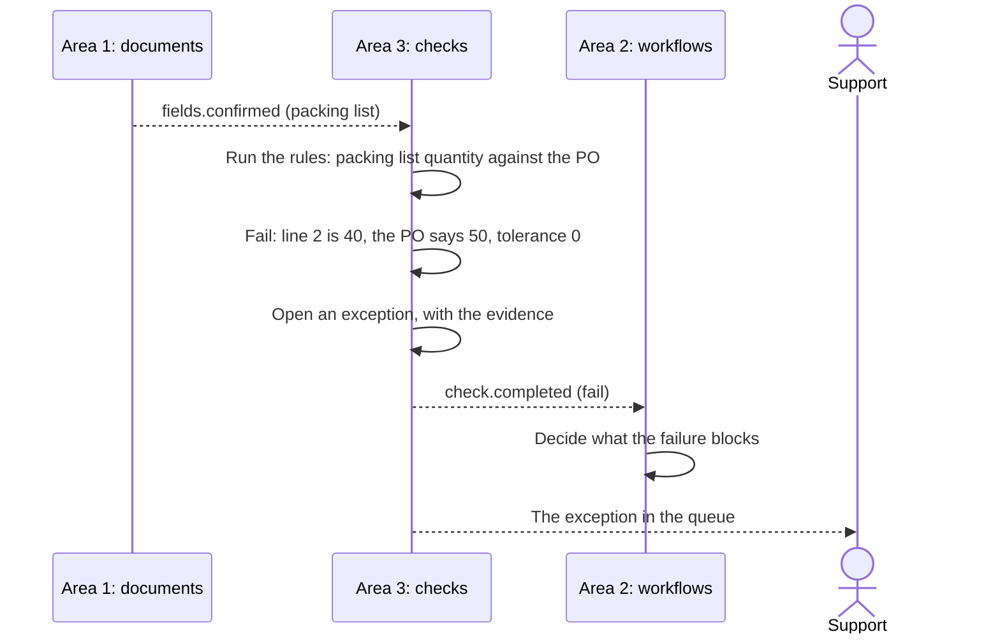

# Area 3: Checks, tracker and insights

**Owner:** Iok Teck. **Backup:** Azri. **Capability:** D, with parts of E. Paths and reviewers are in [module ownership](module-ownership.md#area-3-checks-tracker-and-insights-iok-teck).

## Goal

Catch every disagreement between an order's documents before goods ship, and show every order in one place. Area 3 owns the checks engine and its tolerances, the check results and the exceptions queue, the tracker showing every order's complete history, and the KPIs, Spectra's five measures among them.

### User stories

- As the **warehouse**, I see a packing list whose quantity differs from the PO flagged before I ship, with both documents side by side.
- As **Support**, I work an exceptions queue: each exception says what differs, by how much, against which tolerance, and who should fix it.
- As **Support**, I can read a short explanation of an exception, written by AI and marked as such, with the logs as the source of truth.
- As **Management**, I open one tracker and see every order's status, owner, open actions, exceptions and overdue flags.
- As **anyone with the right**, I open an order and see its timeline: each step, who did it, when, and what it changed.
- As **Management**, I see Spectra's five measures as KPIs, with how each is calculated.

## Contracts

How area 3 meets the others ([How the areas connect](../../CLAUDE.md#how-the-areas-connect)). The event names below are proposals: P-7 drafts the order and event contract, and the team agrees it in Week 3, with every owner reviewing it.

| With   | Area 3 gives                                                                  | Area 3 takes                                                                                                                        |
| ------ | ----------------------------------------------------------------------------- | ----------------------------------------------------------------------------------------------------------------------------------- |
| Area 1 | Requests for an AI explanation of an exception, through area 1's pipeline     | Documents and their confirmed fields, with confidence and source (`document.extracted`, `fields.confirmed`); master data and prices |
| Area 2 | Check results: `check.completed` with pass or fail, the rule and the evidence | Every status change and task event (`order.status-changed`, `task.overdue`), for the tracker                                        |
| Area 4 | Exceptions that need a controlled decision, such as a price override          | The policy's decision on who may see and resolve what; masking of prices                                                            |

- **Area 3 keeps no status logic.** It reads each order's status from area 2's events and shows it. A failed check is reported to area 2, whose state machine decides what the failure blocks.
- **Checks are fixed rules,** never AI. AI only explains an exception, and the explanation is labelled as AI.
- **Match on Navision numbers,** never on names or descriptions: customer No., item No., External Document No. ([data formats](../data-formats.md)).
- **Every tolerance is configuration,** with its value shown in each result.

## Recommended design

- **A Strategy for each check rule.** Each rule implements one interface: which documents it applies to, and an `evaluate` that returns a check result (rule, order, pass or fail, expected, actual, tolerance and links to the evidence). New rules are new classes, with no change to the engine.
- **The engine runs the rules** for an order when a document's fields are confirmed, collects the results, opens an exception for each failure and publishes `check.completed`.
- **The tracker is a read model.** It is built from area 2's events into a table designed for the tracker's queries, paged and indexed, so the tracker never computes status itself.
- **KPIs are formulas over events,** each documented with its definition, so that they match [the success metrics](../design-thinking/success-metrics.md).
- **Money is a value with its currency,** and comparisons state their rounding and tolerance.

The MVP mismatch, from upload to exception:

## What the base gives you

All planned. Each item lands with the story named, and D-1 fills this section in with what actually landed.

- **From D-1, the area 3 base:**
  - the check-rule Strategy interface, the check-result and exception contracts, and an empty exceptions model;
  - routes that return typed mock data, in Swagger;
  - screens wired to them, covering every state: the order tracker (status, owner, overdue flags), an order's detail timeline, the exceptions queue and a KPI dashboard of Spectra's five measures;
  - an order's page that shows each step as a chain, with what each one changed, such as "payment confirmed: packing released" (money postings stay in Navision);
  - the master-data screens' price checks, with P-19's data;
  - `it.todo` tests naming the key cases: the MVP mismatch (the packing list's quantity against the PO), tolerances and the KPI formulas.
- **From the platform:** the shared contracts (P-7); the API shell (P-8); the database and seed orders in different states (P-9); sign-in and the permissions guard (P-10); the web shell (P-11) and the common data table with quick search, saved filters, column settings and export (P-12); the event bus and live updates (P-15); mock Navision's master data (P-19); and the synthetic documents with planted mistakes (P-21).
- **Generated hooks and mocks (planned: P-26):** the base's screens use the typed TanStack Query hooks and MSW mocks that orval generates from the API's OpenAPI spec, through the web app's `ApiClient`. Regenerate them when your routes change; CI fails when they are out of date.

## What's yours to build

**Starter stories,** ready to pull on the board (planned: P-2 seeds them):

- **D-2: the packing-list quantity check against the PO,** the Must mismatch.
- **D-3: the exceptions queue flow:** open, assign, resolve or escalate, with every step audited.
- **D-4: the tracker's status, owner and overdue flags,** from area 2's workflow events.

**The deeper work,** for the A-level depth:

- full matching (Should 3): the PO compared with the PI, invoice, packing list and AWB/BL, line by line;
- more rules (Should 6): prices against the customer's price group, currency, totals, PO references, part numbers and stock;
- partial shipments and substitutions, once Spectra says how they work (Q-8);
- the AI explanation of each exception, through area 1's gateway, labelled as AI;
- the KPIs: each of the five measures as a tested formula, with its lab estimate labelled;
- role home tiles with counts, such as orders waiting on me or orders ready to ship, in our own design, on the shell's home pages;
- full test coverage: every planted mistake in the synthetic documents flagged, and no false alarm on the clean ones.

## Options to consider, not built

Tools that may suit this area. None is installed, pinned or built ([ADR 0020](../adr/0020-options-left-to-the-owners.md)). If you adopt one, bring its ADR, an exact pinned version and a row in the traceability matrix with that story.

- **json-rules-engine** for the check rules. The plan is plain check classes with data-driven settings; adopt the library only if it makes rules easier to read and to change than that.

## At the Week 7 interview

Be ready to explain, in your own code:

- how the Strategy interface lets a new rule be added without changing the engine;
- how a tolerance is set, applied and shown;
- why area 3 keeps no status logic, and how the tracker stays current from events;
- how an exception moves through the queue, and who may resolve it;
- how each KPI is calculated, and why the lab estimates are labelled as such;
- how your tests prove that every planted mismatch is caught.

## Risks

| Risk                                                          | What to do                                                                     |
| ------------------------------------------------------------- | ------------------------------------------------------------------------------ |
| Too many false alarms, so people ignore the queue             | Start strict on quantity only; add tolerances from Spectra's answers (Q-8)     |
| A mismatch is missed because names, not numbers, were matched | Match on Navision numbers only; test look-alike names                          |
| The tracker drifts from area 2's real status                  | Build it only from events; rebuild the read model from the event log in a test |
| KPIs are read as real results                                 | Label every lab estimate; record the protocol and the sample size              |
| Slow queries as orders grow                                   | Page and index every list; test with the full synthetic set                    |

## Module requirements

| Requirement           | How area 3 covers it                                                                      |
| --------------------- | ----------------------------------------------------------------------------------------- |
| M1 Design thinking    | The tracker answers "where is my order?" (HMW-6, HMW-9), and the five measures            |
| M2 GRS by design      | Mismatches caught before shipping, fewer reshipments, and audited exception decisions     |
| M3 AI-assisted coding | AI explanations labelled as AI; prompts kept as `area3-NNN-…`; rows in the AI usage log   |
| M4 Best practices     | Rules as tested Strategies, paged and indexed queries, and tests against planted mistakes |
| M5 Team Git workflow  | Stories on the board, one branch and pull request each, reviews within a day              |
| M6 Deploy and monitor | The KPI dashboard, and overdue orders visible on the tracker                              |
