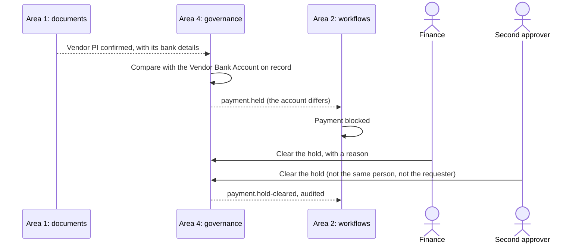

# Area 4: Controls, security and monitoring

**Owner:** Angelyn. **Backup:** Richie. **Capabilities:** F and G. Paths and reviewers are in [module ownership](module-ownership.md#area-4-controls-security-and-monitoring-angelyn).

## Goal

Make sure the right person, and only the right person, does each thing, and that it can be proved afterwards. Area 4 is responsible for the authorisation policy (who may do what, up to which limit, with segregation of duties), the bank-detail control, masking, the audit viewer, the rules for what data may go to which AI provider, and monitoring: traces, metrics, clickstream and the AI's cost.

### User stories

- As the **approver**, I can approve only within my limit, and never a request I raised myself.
- As **Finance**, a payment whose vendor bank details differ from the record is held until I and a second approver clear it.
- As any role **without the right**, I am refused on the server, even if I call the API directly, and the refusal is audited.
- As a role **outside Finance**, I see bank details and prices masked, with the reason.
- As a **Product Manager**, I see only my brands' orders, if Spectra confirms brand ownership (Q-17).
- As a **system administrator**, I can copy a role's permissions to a new one, and disable a user without deleting them; I can never approve or pay.
- As an **auditor**, I can filter the audit trail, check that its hash chain is intact, and export it.
- As **Management**, I can see the AI's usage and cost per document, and how the app is performing.

## Contracts

How area 4 meets the others ([How the areas connect](../../CLAUDE.md#how-the-areas-connect)). The names below are proposals: P-7 drafts the shared contract, and the team agrees it in Week 3, with every owner reviewing it.

| With   | Area 4 gives                                                                                                                                    | Area 4 takes                                                                                   |
| ------ | ----------------------------------------------------------------------------------------------------------------------------------------------- | ---------------------------------------------------------------------------------------------- |
| Area 1 | The policy that area 1's permissions guard calls; the rule for which data may go to which AI provider; masking for every screen                 | AI usage records (`AiUsageRecord`); the extracted bank details of vendor PIs; the audit writer |
| Area 2 | The decision on each approval, release and payment: allowed or refused, with the reason; payment holds (`payment.held`, `payment.hold-cleared`) | Each action before it runs, with the actor, the amount and the requester                       |
| Area 3 | The decision on who may see and resolve each exception; masking of prices                                                                       | Exceptions that need a controlled decision                                                     |

- **The policy is enforced on the server.** Every endpoint that acts calls it, through area 1's guard (planned: P-10). Hiding a button is never the control.
- **One shape for every decision:** allowed or refused, the rule that decided, and a reason a person can read. A refusal returns the standard error envelope `{ error: { code, message, details, traceId } }` and is audited.
- **Approval limits and delegation** follow the shape of Navision's Approval User Setup (User ID, Approver ID, Sales and Purchase Amount Approval Limits, Unlimited flags, Substitute), shared with area 2 ([domain notes](../research/domain-notes.md)).
- **Bank details are compared with the Vendor Bank Account on record** (Bank Account No., SWIFT Code, IBAN). Any difference holds the payment. Area 2's state machine shows the hold and blocks the payment until it is cleared.
- **AI destinations:** area 1's gateway asks area 4's policy whether a piece of data may go to a provider. The default is synthetic data only.

## Recommended design

- **A policy as a domain class.** `decide(actor, action, resource)` reads the role-permission matrix, the data scope (for example, a Product Manager's brands), the limits and the segregation-of-duties rules, and returns a decision. It has no HTTP or Prisma, so every rule can be unit-tested.
- **Rules as a chain.** Each rule (permission, data scope, limit, no self-approval, second approver) is its own class, checked in order, and the first refusal wins with its reason.
- **Masking by classification.** Each field carries a classification (such as bank detail or price), and a masking rule per role decides what is shown, with the reason.
- **The audit trail is append-only and hash-chained** (planned: P-9): the viewer verifies the chain and shows where it breaks, if it ever does.
- **Monitoring:** OpenTelemetry for traces and metrics, `/metrics` for Prometheus, and an `AnalyticsTracker` class on the web that batches events, asks for consent and sends no personal data.

The bank-detail hold:

## What the base gives you

All planned. Each item lands with the story named, and F-1, F-2 and G-1 fill this section in with what actually landed.

- **From F-1, access policy and masking:**
  - the role-permission matrix screen;
  - the masking mechanism, with a neutral sample rule;
  - the classification contracts, the contract for what data may go to which AI provider, and how a refusal looks;
  - room for function permissions (screens and actions) plus a data scope, copying a role, and disabling users rather than deleting them;
  - a payment record with its type, prepayment among them (with C-1);
  - routes that return typed mock data, in Swagger, and screens covering every state;
  - `it.todo` tests naming the key cases: approval limits, no self-approval, the bank-detail hold, masking for each role, and a direct API call being refused (E2E #3).
- **From F-2, the audit viewer:** the audit log viewer over the real hash chain, with filters and a chain check; the audit trail at the foot of every detail page (with P-12's audit link); and `it.todo` tests for export and retention.
- **From G-1, monitoring:**
  - OpenTelemetry traces and metrics, and `/metrics` with prom-client;
  - the `AnalyticsTracker` class (batching, consent, no personal data), a clickstream endpoint and a `ClickstreamEvent` model;
  - the AI usage and cost screen, reading real usage records;
  - the observability and clickstream screens, on mock data, with `it.todo` tests.
- **From the platform:** the shared roles and permissions (P-7); helmet, CORS and rate limiting (P-8); `AuditEvent` with its append-only trigger and the hash-chained writer (P-9); sessions, the permissions guard and the default matrix (P-10); the masked value, confidence badge and audit link components (P-12); and the AI usage records (P-17).
- **Generated hooks and mocks (planned: P-26):** the base's screens use the typed TanStack Query hooks and MSW mocks that orval generates from the API's OpenAPI spec, through the web app's `ApiClient`. Regenerate them when your routes change; CI fails when they are out of date.
- **Optional, off unless configured (planned: G-1):** Grafana's `otel-lgtm` image as a compose profile for traces, metrics and logs, and Sentry for errors in the web app and the API. Each comes with an ADR, a pinned version and a traceability row.

## What's yours to build

**Starter stories,** ready to pull on the board (planned: P-2 seeds them):

- **F-3: the authorisation policy with approval limits,** enforced on the server.
- **F-4: no self-approval and segregation of duties.**
- **F-5: the bank-detail hold,** cleared only by Finance and a second approver.

**The deeper work,** for the A-level depth:

- the real role-permission matrix for all nine roles, and the data scope by brand (Q-17);
- the masking rules for each role, each with its reason;
- classification of every sensitive field, and the rules for what may go to which AI provider (R-03 in [GRS by design](../grs/grs-by-design.md));
- delegation: a substitute approver while the approver is away, with the same limits;
- audit export and retention per record type;
- E2E #3 and the area 4 half of E2E #4, end to end;
- the real dashboards, budgets and alerts for traces, metrics, clickstream and AI cost, in Weeks 14 to 16 (Sprints 13 to 15);
- the PDPA framing in [GRS by design](../grs/grs-by-design.md#risk-register) (R-04), kept current. Never claim that the prototype is PDPA compliant.

## Options to consider, not built

Tools that may suit this area. None is installed, pinned or built ([ADR 0020](../adr/0020-options-left-to-the-owners.md)). If you adopt one, bring its ADR, an exact pinned version and a row in the traceability matrix with that story.

- **CASL** for expressing permissions in the web app. The authorisation policy stays on the server; CASL could only mirror its decisions for the UI.
- **PostHog** for product analytics. `AnalyticsTracker` and the clickstream screens are the plan; PostHog would need a decision about consent and about where the data is stored.

## At the Week 7 interview

Be ready to explain, in your own code:

- why the policy is enforced on the server, and how a test proves it with a direct API call;
- how a decision is made: which rules run, in what order, and how the reason is chosen;
- how no self-approval and the second approver are enforced;
- how the bank-detail hold works, and why it compares with the record and never trusts the PI;
- how masking chooses what each role sees;
- how the audit chain proves that nothing was changed;
- what the clickstream collects, how consent works, and why no personal data is sent.

## Risks

| Risk                                                      | What to do                                                                        |
| --------------------------------------------------------- | --------------------------------------------------------------------------------- |
| An endpoint forgets to call the policy                    | A test that lists every acting route and checks it is guarded; E2E #3             |
| A rule is right in the UI but missing on the server       | Test every rule through the API, not only the screens                             |
| A bank-detail change slips through on a format difference | Normalise the account number, SWIFT code and IBAN before comparing; test variants |
| Over-masking makes the app useless for a role             | Agree the masking table with Spectra (Q-12, Q-15); show the reason, not a blank   |
| Analytics collect personal data                           | No personal data by design; consent first; review every new event                 |
| A claim of compliance creeps into the proposal            | State what the controls do, and never that they make the prototype compliant      |

## Module requirements

| Requirement           | How area 4 covers it                                                                                  |
| --------------------- | ----------------------------------------------------------------------------------------------------- |
| M1 Design thinking    | Finance's and the auditor's needs (HMW-8, HMW-11)                                                     |
| M2 GRS by design      | The policy, segregation of duties, limits, the bank-detail hold, masking, audit and the AI data rules |
| M3 AI-assisted coding | The rules for data sent to AI, the AI cost per document, and prompts kept as `area4-NNN-…`            |
| M4 Best practices     | Server-side authorisation tested with direct calls, and security headers and limits kept              |
| M5 Team Git workflow  | Stories on the board, one branch and pull request each, reviews within a day                          |
| M6 Deploy and monitor | Traces, metrics, clickstream and the AI cost, with dashboards and alerts                              |
